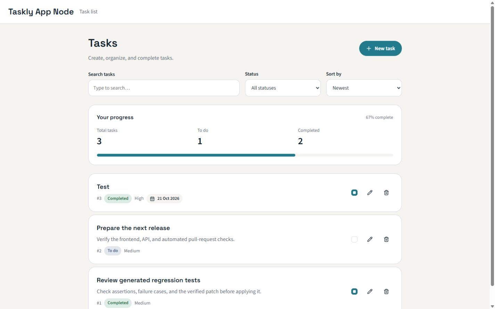

# Taskly App Node

Taskly is a task manager with a custom unit-test agent and an automatic GitHub pull-request workflow. Create, edit and complete tasks, set priorities and due dates, and search, filter or sort the list.

Based on [cf-recruitment/taskly-app-node](https://github.com/cf-recruitment/taskly-app-node).

## Start here

- [Solution and design decisions](SOLUTION.md): agent architecture, reusable skills, security boundaries, prerequisites and limitations.
- [Example feature PR #12](https://github.com/Macieyou/taskly-agent/pull/12): task progress overview and summary API, with automated agent results. This feature remains on `feat/task-summary` for review.
- [Verified agent runs](docs/example-run.md): original reports, generated patches, selected skills and measured coverage changes.
- [UI validation](docs/ui-quality.md): desktop/mobile, keyboard, accessibility and performance evidence, including its limits.
- [CI runs](https://github.com/Macieyou/taskly-agent/actions/workflows/ci.yml): lint, formatting, types, tests, builds and container smoke checks.



The screenshot shows the example feature branch, including its progress overview. The default `main` branch contains the base task manager and test agent.

## Technology

| Area         | Tools                                                                              |
| ------------ | ---------------------------------------------------------------------------------- |
| Frontend     | React, strict TypeScript, Vite                                                     |
| Server state | TanStack Query for queries, mutations and caching                                  |
| Styling      | styled-components, a shared design system and CSS                                  |
| Backend      | Node.js, Express, Zod validation                                                   |
| Database     | PostgreSQL, Prisma ORM                                                             |
| Tests        | Vitest, React Testing Library, MSW, Supertest, Node test runner                    |
| Quality      | Type-aware ESLint, Prettier, GitHub Actions                                        |
| Test agent   | Custom Node.js controller, reusable skills, Gemini, isolated Docker test execution |

This is a shared demonstration application without authentication or user accounts. Use example data. Running the application and deterministic tests requires no AI API key; only model-backed test generation needs one.

## Quick start with Docker

Prerequisites: Git and a running Docker Engine with Docker Compose v2 (or Docker Desktop). Host Node.js is not required for this route.

```sh
git clone https://github.com/Macieyou/taskly-agent.git
cd taskly-agent
cp .env.example .env
docker compose up --build -d --wait
```

In PowerShell, `Copy-Item .env.example .env` is the equivalent copy command. Create `.env` once; preserve your existing configuration on subsequent starts.

- Application: http://localhost:8080
- API documentation: http://localhost:8000/docs
- API readiness: http://localhost:8000/api/health

The example environment uses local development credentials and ports 8080, 8000 and 5432. Keep those ports free. Compose publishes the services on localhost and persists PostgreSQL data in a named volume. The backend creates the initial `todos` table when it starts.

To preview the feature shown above, switch branches before building:

```sh
git switch feat/task-summary
docker compose up --build -d --wait
```

Stop the application while retaining database data:

```sh
docker compose down
```

To investigate startup failures:

```sh
docker compose ps
docker compose logs --tail=100 backend frontend postgres
```

If Docker itself cannot start, resolve that before running Compose. A factory reset is not an application setup step.

## Local development

Use Node **24.22.1 LTS**, pinned in `.nvmrc` and `.node-version`. With NVM installed: `nvm install 24.22.1`, then `nvm use 24.22.1`. PostgreSQL is required to run the backend, but not for unit tests.

From the repository root, after creating `.env`:

```sh
npm ci
npm ci --prefix frontend
npm ci --prefix backend
npm ci --prefix agent --ignore-scripts
docker compose up -d --wait postgres
```

If the full Docker application is already running, first run `docker compose down` to release the backend port, then start only PostgreSQL as above.

Run the backend in one terminal, from the repository root:

```sh
npm run dev --prefix backend
```

Run the frontend in another terminal, also from the repository root:

```sh
npm run dev --prefix frontend
```

Open http://localhost:5173. Vite proxies `/api` to the backend at `127.0.0.1:8000`. If you change `API_PORT`, update the proxy in `frontend/vite.config.ts` too.

Storybook is available at http://localhost:6006 after:

```sh
npm run storybook --prefix frontend
```

## Tests and code quality

After installing dependencies as above, run these commands from the repository root:

```sh
npm run lint
npm run format:check
npm run typecheck --prefix backend
npm run typecheck --prefix frontend
npm run test:coverage --prefix backend
npm run test:coverage --prefix frontend
node --test agent/*.test.mjs
npm run build --prefix backend
npm run build --prefix frontend
```

Coverage HTML is written to `backend/coverage/index.html` and `frontend/coverage/index.html`. Unit and controller tests require neither a running database nor an API key. CI additionally exercises the containers with real PostgreSQL.

For quick test runs use `npm test --prefix backend` or `npm test --prefix frontend`; both packages provide `test:watch`. Use `npm run lint:fix` for automatic ESLint fixes and `npm run format` for shared formatting.

CI rejects lint warnings/errors and formatting differences. Authored TypeScript rejects explicit `any`, unsafe type assertions and non-null assertions. API responses remain `unknown` until validated. Component tests use real components, isolated query providers and MSW at the HTTP boundary. Generated code, build output, coverage and archived evidence are excluded from formatting/linting. Engineering conventions live in [AGENTS.md](AGENTS.md).

## Run the PR test agent

The agent analyzes production TypeScript changes, loads [reusable skills](agent/skills), proposes tests and checks both complete suites, types and before/after coverage in Docker. Only verified proposals produce a `tests.patch`; a bot comment links to the report and artifacts. Applying the patch requires human review. The workflow never automatically commits or merges it.

To enable model-backed generation in your own repository:

1. Add the GitHub Actions repository secret `GEMINI_API_KEY`.
2. Optionally set the repository variable `GEMINI_MODEL`; its default is `gemini-3.1-flash-lite`.
3. Open or update a non-draft PR with production TypeScript changes from a branch in the same repository, as a trusted contributor.
4. Inspect the **PR test agent** workflow and its PR comment. Review the report and verified patch before applying it.

Provider quotas and model availability apply. External fork and Dependabot PRs do not receive model credentials. See [SOLUTION.md](SOLUTION.md) for the full trust model, local Linux reproduction, patch application steps and failure handling, and [docs/example-run.md](docs/example-run.md) for demonstrated results.

## Database and backend build

The Prisma schema is in `backend/prisma/schema.prisma`; local connection settings come from the root `.env`. On startup the backend runs `CREATE TABLE IF NOT EXISTS` for the initial table. This is demo initialization, not a versioned migration system, and it does not migrate an existing table when the schema changes. Production schema evolution would need versioned migrations.

From the repository root:

```sh
npm run db:validate --prefix backend
npm run db:generate --prefix backend
npm run db:studio --prefix backend
```

Client generation also runs during backend installation and build; it does not change the database. To build and start the backend outside Docker, with PostgreSQL running:

```sh
npm run build --prefix backend
npm start --prefix backend
```
